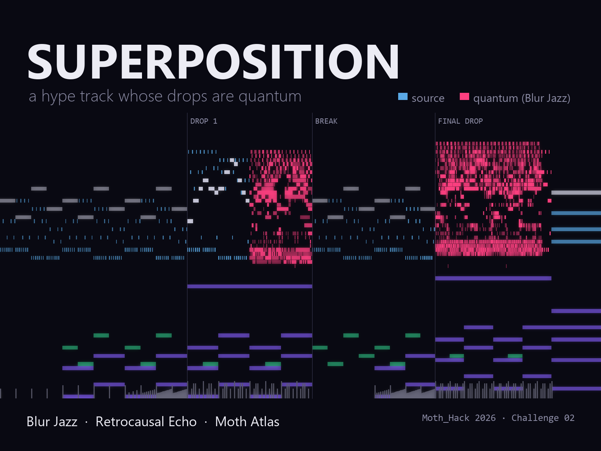

# Superposition

**A hype track whose drops are quantum.** Moth_Hack 2026, Challenge 02 (Make it audible).



🎧 [`audio/superposition.mp3`](audio/superposition.mp3) · alternate mix: [`audio/superposition_collapse_alt.mp3`](audio/superposition_collapse_alt.mp3)

Superposition is an original 75-second hybrid trailer track (orchestral and electronic), composed and synthesized in Python. A ticking intro and a relentless 16th-note string ostinato build into drop 1, where the synth hook plays cleanly for four bars. Then Moth's **Blur Jazz** engine collapses it into a cloud of quantum-chosen notes. In the break the drums fall away and **Retrocausal Echo** takes over. It's a delay whose taps are measured from a quantum spin chain, and negative taps play their grain in reverse. Build 2 speeds up from 140 to 150 BPM and cuts to half a bar of silence. The final drop lands a tone higher and is quantum throughout.

## Pipeline

| Step | Script | What it does |
|---|---|---|
| 1 | `compose.py` | Writes the source MIDI (40 bars, Dm–B♭–F–C, a tempo event per beat, final drop up a tone). Strings and lead are written with no rests, because Blur Jazz mishandles rests. |
| 2 | `run_blur.py` | Uploads the MIDI to Moth Atlas and runs **blur-midi-v1** masked to the strings and lead in both drops. Main mix: `strength 0.55, reach 0.3, margin 0.2, threshold 0.1`. |
| 3 | `fix_midi.py` | Arranges the quantum output. Drop 1 plays the clean hook for 4 bars, then the quantum version. Notes snap to the 16th grid. Velocities are rescaled per step so the strongest quantum note gets the original level, with relative quantum weights kept. Pitches are untouched. |
| 4 | `instruments.py` | numpy synth: spiccato strings, braam brass, supersaw lead, sub bass, synthesized drums, risers, impacts. |
| 5 | `mix.py` | Renders the stems, sends the strings, lead and impacts through **retrocausal-echo-v1** (12-site spin chain, depth 14, `negative_mode: reverse`, emulated on `aer`), then mixes with sidechain, an energy curve, and true silence before the final drop. |
| 6 | `media/make_media.py` | The poster and demo video, drawn from the real MIDI and echo return. |

In the masked bars Blur Jazz turned 306 source notes into 2,830 quantum notes. All parameters and job IDs are in [`audio/params.json`](audio/params.json).

## Run it

```bash
pip install -r requirements.txt
echo "MOTH_API_KEY=your_key" > .env        # Moth Atlas API key
cd 02_audible/superposition
python compose.py                          # source MIDI
python run_blur.py                         # Blur Jazz on Atlas (both variants)
python fix_midi.py hype                    # arrange the quantum output
python mix.py hype                         # Retrocausal Echo on Atlas + final mix -> output/
```

`ffmpeg` must be on the PATH for the mp3 export. `atlas.py` is a small client for the Moth Atlas REST API: upload assets, submit engine jobs, poll and download.

## Notes on the engines

- **blur-midi-v1** drops the delta time on a `note_on` that follows a rest, so later notes move earlier. It can also add notes outside its mask. Writing the masked parts with no rests and rebuilding from the source outside the mask avoids both.
- At strength 0.55 on dense 16ths, each note becomes about 7 low-velocity notes per step. That's why `fix_midi.py` rescales velocity per step.

Built with Claude Code (Anthropic) as a coding assistant.
